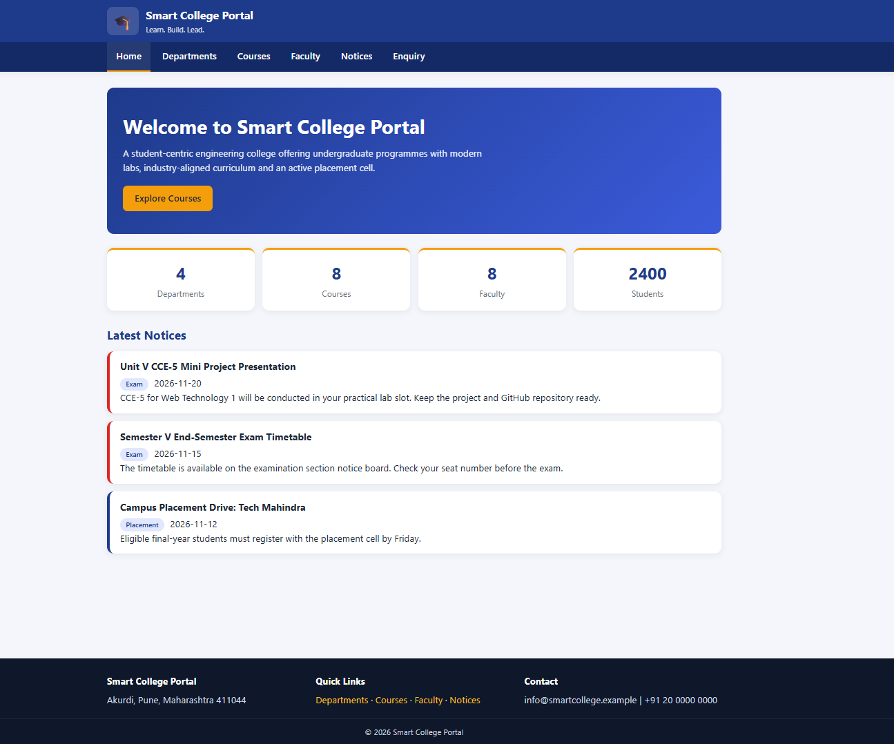
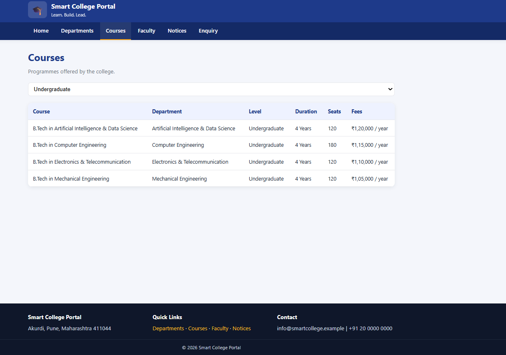
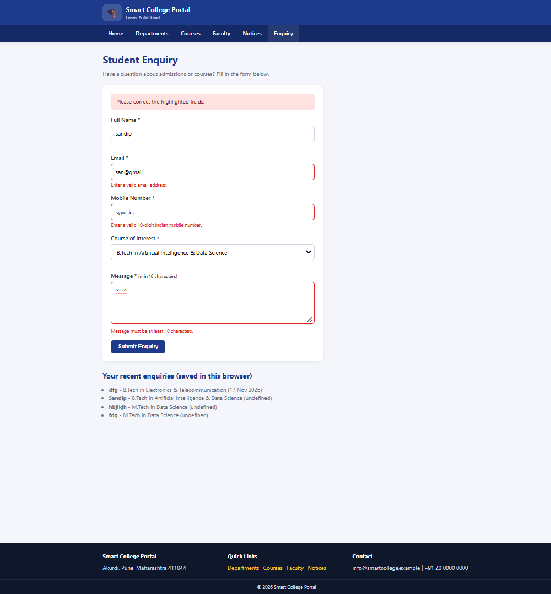
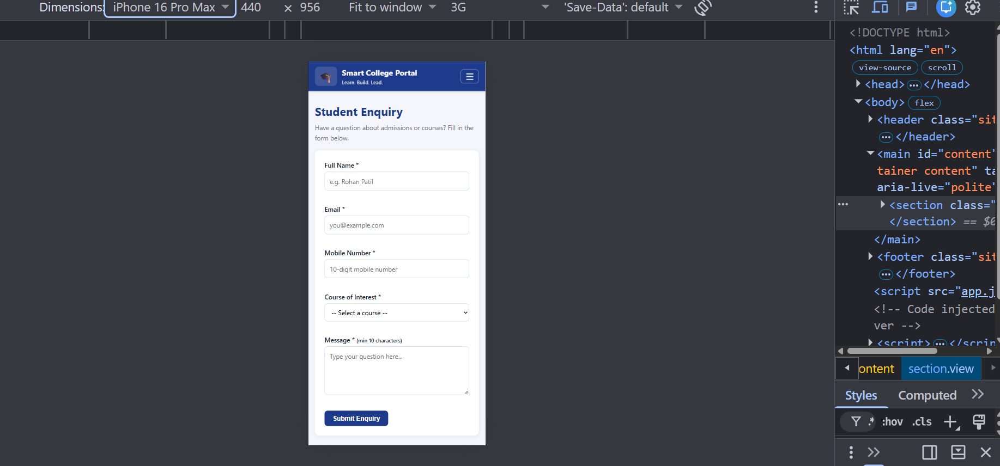

# Smart College Website Portal


## Problem Statement
Prospective and current students find it hard to get college information (departments, courses, faculty, notices) in one place. This project is a responsive, data-centric front-end portal that shows this information and lets students send an enquiry, all without any page reload.

**Users:** prospective students, current students, parents, faculty.

## Features
- **SPA-style navigation:** pages change without a full reload.
- **Client-side routing (JavaScript):** hash-based router (`#/home`, `#/departments`, `#/courses`, `#/faculty`, `#/notices`, `#/enquiry`) with a 404 page, active-link highlighting and browser back/forward support.
- **Page layout:** Header, Navigation, Content area, Footer.
- **Dynamic data loading:** all content is loaded from separate JSON files (`data/college.json`, `data/notices.json`, `data/departments.json`, `data/courses.json`, `data/faculty.json`) using `fetch()`.
- **Courses:** filter by level.
- **Faculty:** filter by department.
- **Notices:** category filter, important notices highlighted, newest first.
- **Enquiry form with client-side validation:** name, email, 10-digit mobile, course, message (min 10 chars); inline errors; submissions saved in `localStorage`.
- **Responsive UI:** mobile hamburger menu, fluid grids, scrollable table.

## Project Structure
```
index.html          - page skeleton (Header, Nav, Content area, Footer)
style.css           - styling and responsive rules
js/
  data.js           - loads the JSON files, holds the shared data
  component.js      - reusable pieces: notice card, form validation, enquiry storage
  views.js          - one function per page (home, departments, courses, faculty, notices, enquiry)
  route.js          - hash-based router and active-menu highlighting
  app.js            - entry point: menu toggle, router events, start-up
data/
  college.json      - college info (name, about, stats, contact)
  notices.json      - notices
  departments.json  - departments
  courses.json      - courses
  faculty.json      - faculty
README.md           - documentation
```

## How to Run
1. Clone or download the repository.
2. Open the folder in VS Code.
3. Right-click `index.html` → **Open with Live Server** (a local server is required because `fetch()` cannot read the JSON files from `file://`).
4. Alternative: run `python -m http.server 5500` in the folder and open `http://localhost:5500`.

## Screenshots







## Technologies
HTML5, CSS3 (Grid, Flexbox, media queries), JavaScript (ES6, Fetch API, hash-based routing, localStorage).

## Testing Checklist
- [✔] All six routes open without page reload
- [✔] Filters update results instantly
- [✔] Form blocks invalid input and shows errors
- [✔] Layout checked at desktop and mobile widths

## Author
Name: Sandip Bankar
Roll No:TY2627AID002  Batch: A1
Repository name format: `WT_CCE5_TY2627AID002_SmartCollegePortal`
